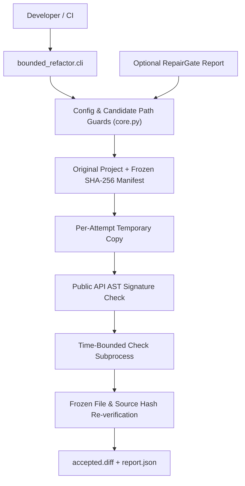
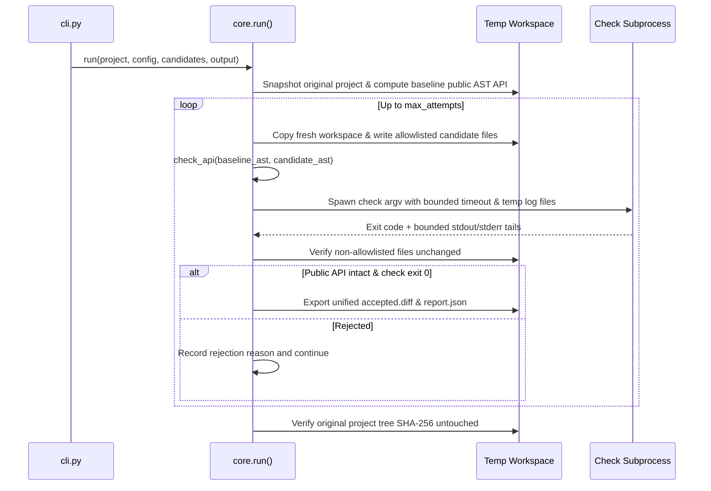

# Architecture: bounded-refactor

Crosscheck: 2026-11-08 WIB. The repository-local offline checks completed with exit code 0 in an interpreter/environment containing the declared dependencies. Hardware, live providers, deployment and unexecuted CI platforms are separate evidence boundaries.

Reviewed on 2026-11-07 against the local working tree (`.`). `graphify-out/graph.json` provides the local AST symbol graph.

## 1. System Context & Data Flow

Bounded candidate-replacement evaluator that verifies file allowlists, public Python AST signatures, subprocess check timeouts, and frozen test/source SHA-256 manifests inside isolated temporary copies before exporting `accepted.diff` and `report.json`.



## 2. Execution & Pipeline Sequence



## 3. Module Breakdown

| Path | Responsibility |
| :--- | :--- |
| `bounded_refactor/core.py` | Config/candidate schema & path-traversal validation, streaming `file_digest` SHA-256 manifest hashing, AST public signature extraction (`__all__`, sync/async functions, classes), process-tree timeout cleanup, and diff/report export. |
| `bounded_refactor/cli.py` | CLI argument parser and exit-code mapper (`0` accepted, `1` rejected, `2` config/input error). |
| `fixtures/project` | Synthetic broken arithmetic package (`pkg/mathutil.py`) and test suite used for deterministic local verification. |
| `tests/test_bounded_refactor.py` | Core acceptance, path-escape, API-breakage, timeout, RepairGate precondition, and source-immutability tests. |
| `tests/test_audit_regressions.py` | Regression coverage for encoding, symlink/path alias handling, and boundary conditions. |
| `tests/test_comprehensive_unit.py` | Additional unit and pipeline boundary coverage. |

## 4. State Management & Failure Handling

Original repository files are never modified in place: `run()` copies originals into a preserved snapshot and creates a fresh `TemporaryDirectory` per candidate attempt. Both before and after verification, `file_manifest()` hashes the original tree to detect any out-of-band mutation.

## 5. Verification Commands

```powershell
Set-Location '.'
& 'C:\Python314\python.exe' -m pytest -q
```

## 6. Integration Boundaries

Executes configured local check commands with current-user OS permissions; temporary directory isolation is an audit boundary rather than a kernel sandbox.
